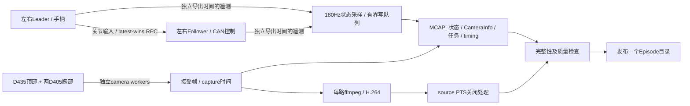

# YAM 数据采集工程审计与交付报告

审计日期：2026-11-15。审计对象是当前本地源代码、配置、部署日志、交接快照、用户指定的“新增机械臂定点移动与采集前主从臂同步就位”历史对话，以及可访问的真实MCAP/MP4数据。报告中的“源码确认”“实测”“历史记录”“工程推断”分别标识不同证据强度；未知项不以猜测补齐。

交付包括11份专题文档、核心模块接口清单、英中README、完整复现指南、匿名统计CSV/JSON、保留原包边界的独立代码副本及校验清单。原始业务文件没有修改，没有启动真实机械臂、相机或完整采集，没有删除原始数据，也没有执行GitHub、git add/commit/push或Git历史改写。

## 主要审计结论

| 事项 | 结论与影响 |
|---|---|
| 系统可辨识性 | 当前双臂queued/H.264-final、单臂selected-side和旧HEVC/其他相机profile是不同路径，已分别说明 |
| 真实数据规模 | 3,400个Episode，3,402个关联H.264视频，2,115,579帧，35,308.611418s机器人记录跨度（含ARMING） |
| 状态语义 | Leader七维位置含映射手柄输入，Follower三数组各七维；常规MCAP没有实际CAN命令流，不能把Leader输入一概称为已执行Action |
| 频率 | 记录配置180Hz，组内实测约179.993–180.063Hz；500Hz sleep上限和250Hz CAN估算常量均不是实测控制率 |
| 源连续性 | 1,414个相机设备帧号缺失、13,259个机器人Header重复；零writer序号缺口不证明零源丢样 |
| 时间同步 | 使用主机导出时间/RealSense global time和最近邻匹配，无硬件同时曝光或每电机硬件时钟证明 |
| 元数据 | 所有3,399个单臂文件仍使用SINGLE_ARM_SMOKE_TEST，真实语义任务统计无法可靠完成 |
| 历史可追溯性 | 没有可用Git对象；可比对11月12日快照的14个差异路径，但不能给出commit级架构演变 |
| 离线代码验证 | 异路径临时副本导入隔离，461项采集/单臂/部署、43项控制mock、183项模型装配/仿真测试通过，共687项 |
| 复现边界 | 依赖重用现有第三方安装做验证，未验证干净网络安装或实机性能；发布配置需现场填写和重新核验 |

## 1. 系统整体架构

完整部署使用左右各一Leader和一Follower，共四条YAM；四条独立1Mbps SocketCAN链、两个Follower控制RPC和两个Leader遥测RPC。控制器拥有CAN，记录进程只读Portal遥测；每相机独立读取、每视频独立编码，状态写入与相机元数据共用MCAP writer锁。当前`yam.sh capture`走`QueuedEpisodeCollector`，基础`yam-data-collect capture`走`EpisodeCollector`；新增单臂类继承queued路径并限制设备集合。

完整硬件连接、线程锁/队列和数据流见[01](01_yam_data_collection_architecture.md)。未发现当前业务ZED后端，不把其他SDK型号或D405640×480历史候选拼入当前host配置。

## 2. 核心代码清单与来源

独立源码副本包含246个来源文件，共78,479,153 bytes；19个文件因设备身份、任务、手柄端点及对应测试fixture脱敏而改变。其余文件按字节保留。`src/i2rt`144个来源文件、`src/yam_data_collection`67个、`src/yam_single_arm_collection`25个，另有部署/迁移/根入口。

核心包括硬件工厂、MotorChainRobot、CAN事务驱动、Leader/Follower进程与共享遥测、单臂配对就位、相机后端、采集器、MCAP writer、视频编码/时间线、质量检查、发布/锁、导出及测试。[12](12_core_code_inventory.md)逐项解释文件、类/函数、输入、输出、依赖及调用者。逐文件SHA-256见`SOURCE_MANIFEST.json`；静态接口见[release_symbols.json](audit/release_symbols.json)。

递归原始树和逐文件清单保存在本地`docs/audit/`，排除虚拟环境/runtime、缓存、凭据与工具元数据；业务源扫描142个Python文件，含交接重复副本的文件清单另计。未发现项目自有C/C++源文件。公开包只分发脱敏的发布树及所选源码清单，避免暴露原始采集者目录。

## 3. YAM Leader–Follower 控制机制

源码默认YAM v1：每臂六关节，ID1–3为DM4340、4–6为DM4310；Follower加ID7 linear_4310/DM4310夹爪，Leader加被动teaching handle。左右按同一关节顺序一对一映射，无镜像变换和跨侧控制屏障。按钮0切换同步，接通时约3秒平滑跟随就位；持续跟随目标经latest-wins队列/RPC送Follower，SDK应用方向/offset、归一化夹爪映射、增益、重力补偿与限力。

CAN接口为can_leader_l/can_follower_l/can_leader_r/can_follower_r，gs_usb VID/PID1d50:606f，商业型号待确认。当前部署1Mbps、restart-ms0、txqueuelen2000，启动要求ERROR-ACTIVE。CAN有独立事务线程、状态/命令锁、超时及有限重试；没有USB断连自动无缝恢复保证。本机bilateral Kp为0。

新增预编程路径默认各自读取实时起点，关节计划上限1rad/s、夹爪0.25/s、25Hz发送、时长0.5–120s、到位容差0.12rad/0.12。被动Leader夹爪不能自动驱动；到位前需人工调到目标附近。无碰撞规划。关节工厂将模型限位两侧各扩大0.15rad，不能误读成收窄安全边界。完整控制、零位、使能和停止语义见[02](02_yam_robot_and_leader_follower.md)。

## 4. 实际采集的机器人状态与Action

| 记录 | 真实内容 | 未记录/不可等同内容 |
|---|---|---|
| Leader JointState | 六关节测量缓存+归一化手柄输入position[7] | velocity/effort置空；不是七维纯原始encoder数据 |
| Follower JointState | position/velocity/effort各7个float64 | 不包含EE pose、温度、motor status、raw encoder count |
| 夹爪 | position末维归一化，velocity末维归一化/s，effort末维电机Nm | 不是夹持力N、接触状态或离散开闭真值 |
| 目标控制 | 同步时Leader输入或显式计划，经RPC/SDK处理 | 常规MCAP没有独立命令Topic和同步开关 |
| LeRobot Action | 导出时最近邻右Leader[7]+左Leader[7]，float32[14] | 不等于Follower反馈或逐条已发送CAN命令；只支持双臂四状态/三相机 |

六关节单位分别为rad、rad/s、电机协议Nm。effort的传动侧精度未在本次标定。字段来源、缺失率口径和物理意义见[03](03_yam_robot_state_collection.md)。

## 5. 状态流维度和实际频率

| Topic角色 | 全量消息数 | position / velocity / effort维度 |
|---|---:|---|
| 左Leader | 3,713,286 | 7 / 0 / 0 |
| 左Follower | 3,713,286 | 7 / 7 / 7 |
| 右Leader | 2,651,637 | 7 / 0 / 0 |
| 右Follower | 2,651,637 | 7 / 7 / 7 |

全部12,729,846条JointState均符合相应维度，NaN/Inf=0。记录目标180Hz；各组加权平均179.993244–180.062634Hz，最大log间隔22.028357ms。log时间无重复/逆序，source Header共13,259次重复、无倒退。逐路平均/中位频率、平均/中位/P95/最大间隔、抖动和最大年龄见[08](08_yam_data_audit.md)及[topic_statistics.csv](audit/data/topic_statistics.csv)。没有源序号/真实命令流，精确源丢样数及控制发送率待确认。

## 6. 相机型号、参数与采集方式

| 名称 | 硬件/安装角色 | 当前60Hz | 另有30Hz配置 | 像素 |
|---|---|---|---|---|
| cam_high | RealSense D435 / 顶部 | 960×540@60 | 1280×720@30 | YUYV422 uint8，两字节/像素 |
| cam_left | RealSense D405 / 左腕 | 848×480@60 | 1280×720@30 | 同上 |
| cam_right | RealSense D405 / 右腕 | 848×480@60 | 1280×720@30 | 同上 |

仅启用color，不采Depth、无正式录制crop/resize/去畸变。显示预览会转换/缩放，但不改变记录分辨率。每设备native queue8、独立读取线程；视频队列默认120（camera-test240）。SDK为pyrealsense2 2.56.5.9235。左腕更换设备后使用对应出厂内参；顶部/右腕历史标定不自动适用于新设备。[04](04_yam_camera_collection.md)包含初始化、全局时间和异常机制。

## 7. 实际相机FPS与视频验证覆盖

唯一双臂样本顶部/左腕/右腕分别59.529870/59.895123/59.852998FPS。其余单臂组的腕部加权FPS约59.813796–59.890807；实际逐Episode均值范围59.006798–60.239267FPS。所有关联视频为H.264：顶部1个、左腕1,988个、右腕1,413个。最大相机capture间隔50.090240ms。

3,402个视频头帧数与对应CameraInfo消息数全部一致；仅12个视频（9,635帧）做了完整像素解码和PTS检查。额外14个camera-test视频共37,306帧，已单列容器统计，不算作Episode。全量统计不等于已对每个MP4逐帧解码。

## 8. MCAP Topic、Schema与时间戳

双臂9个Topic，单臂腕部5个。四路JointState使用`sensor_msgs/msg/JointState`；三路相机元数据使用`sensor_msgs/msg/CameraInfo`；`/task_info`和`/diagnostics/frame_timing`使用`std_msgs/msg/String`承载JSON。Schema编码ros2msg、message编码cdr，无需运行ROS图。

相机Topic虽然含`image_raw/compressed`字样，真实内容只有CameraInfo，没有像素。CameraInfo数：cam_high1,386、cam_left1,233,489、cam_right880,704；task_info3,400、frame_timing3,402。所有消息共14,852,227条。完整字段、topic路径、writer创建/锁/finish过程见[05](05_yam_mcap_and_video_recording.md)。

## 9. 视频编码与保存

当前live和final均libx264、CRF23、ultrafast、每路1线程、avc1、yuv420p、faststart；没有显式GOP。像素进入有界队列后持续送ffmpeg，不在内存中缓存整个Episode。source模式关闭时优先packet remux重建PTS，必要时decode/re-encode fallback并验证。

旧HEVC配置是停止后libx265转码、hvc1标签的另一流程，未将现存H.264文件误报为HEVC。成品为一个MCAP加videos目录及source_timeline.json，通过检查后发布；发布有阶段文件和rollback，但没有多文件掉电原子性保证。

## 10. 时间同步方案和实测误差

机器人Header/publish为控制worker导出缓存的host Unix time；MCAP log为记录器该批RPC完成时的采样时间，queued后保留，不是实际落盘时间。相机采用RealSense global time映射至主机时钟并保留host_receive/device时间。monotonic只用于调度/超时。没有外部触发、PTP或每关节硬件时间戳证据。

CameraInfo按接受帧顺序与视频对应。source timeline用最早首个机器人source时间作origin，源纳秒转微秒PTS；12个解码样本均有−972至−10µs固定mux起点偏移，逐帧相对间隔完全匹配。消费者应读取实际PTS并处理固定偏移。

逐相机→逐路状态有方向最近邻绝对差最大9.437521ms；唯一双臂样本相机间最大9.604352ms。最大机器人log-publish年龄19.787908ms，最大相机host-capture差19.640199ms。这些是记录时间匹配/可观测年龄，不是同时曝光精度、真实CAN总时延或机械跟随延迟。算法和所有配对分布见[06](06_yam_timestamp_and_synchronization.md)、[08](08_yam_data_audit.md)。

## 11. 丢帧、队列与数据完整性

frame_timing结尾按相机批量保存capture/host/device时间、frame number及domain/source，可区分设备帧号缺口与host交付抖动。全量发现1,414个设备缺号（左腕688、右腕726、顶部0），相机时间戳无重复/倒退。S01诊断Topic的两次log回退来自不同role关闭顺序，不能称为同一相机帧倒退。

当前yam_60hz允许59.0–60.5FPS、最大69ms间隔、17ms时间匹配；strict为59.5–60.5FPS、35ms及精确分辨率。部分现存间隔不满足strict。基础双臂关节图像检查合并四路状态，单臂分别检查选中Leader和Follower；本次独立审计也逐路统计，没有将合并检查误当成逐臂保证。

56份运行JSONL记录的pipe写入最大451.593819ms、队列高水位10、软件dropped_frames峰值0。软件无丢弃与设备缺号是不同层次。MCAP writer序号连续且字段完整只能说明接受后记录的局部一致性；源样本损失、强杀/掉电或未保存诊断仍有证明边界。

## 12. Episode组织与数据规模

Episode生命周期为idle→约2s arming→recording→finalizing→终端review→idle。空格开始，Enter保存/复核保留，q丢弃或删除；Ctrl+C退出采集器不等于硬件急停。没有单Episode中途暂停/续录保证。编号扫描已存在/pending/live目录防覆盖，dataset有排他操作锁。

真实Episode包含时间命名MCAP、每路cam_*.mp4及source_timeline.json；dataset另存record_config.yaml、runtime_diagnostics及可选删除账本。config快照可能被后续启动重写，不是逐Episode不可变溯源。

现存记录累计35,308.611418s，平均10.384886s、中位10.150673s、最短5.013693s、最长23.294171s。MCAP+关联MP4共19,990,204,169 bytes；两个data根含辅助日志共23,865,321,477 bytes。全部3,400条匿名逐Episode时长见08的CSV；数据原件不随代码包分发。

## 13. 历史Bug与证据等级

| 编号 | 已观察事实 | 修复/闭环证据 |
|---|---|---|
| B01 | gs_usb不支持非零Bus-Off restart参数，初始化报错 | 配置改restart-ms0；历史四接口健康验收及当前门禁一致 |
| B02 | 顶部早期约59.45–59.49Hz、单独/无视频/曝光对照仍出现 | 后续约59.529Hz通过，但根因及与代码修复因果未闭环 |
| B03 | 30Hz右腕29.678Hz、最大100.005ms间隔 | 未见后续闭环，不与60Hz通过结果合并 |
| B04 | 左腕替换后旧标定身份不匹配 | 改用实际设备factory intrinsics；MCAP解码确认真实畸变模型 |
| B05 | 同长Future超时可能遮蔽首帧后端错误 | 快照差分/源码/回归支持改为保留role和cause；现场事故细节不全 |
| B06 | 对话记录右CAN ERROR-PASSIVE及Hub重连 | 无持久原始kernel日志/最终验收，具体硬件根因待确认 |
| B07 | 对话记录read-poses NumPy按钮数组JSON序列化问题 | 当前转list及对应离线测试支持；原完整堆栈未保留 |
| B08 | 两份runtime会话分别出现左右腕取帧超时，首次状态idle | 日志事实已确认，根因与恢复验收待确认 |

完整“现象→排查→证据→修复→验证→预防”见[09](09_yam_debugging.md)。119,040条相机错误状态快照包含持续保留，不能当作独立故障次数。删除账本仅记37条validation_failed及129条user_deleted，不能重建已删除样本或整个历史失败率。

## 14. 核心代码包大小、许可和独立性

来源文件246个、78,479,153 bytes（约74.844MiB）；其中SDK模型76个文件、76,242,844 bytes，是主要体积来源。保留模型供重力补偿、仿真和相对资源定位使用；SDK内其他型号不表示本项目硬件。完整目录的附加文档/统计/脚本大小见发布根`PACKAGE_SUMMARY.json`，逐文件哈希见`SHA256SUMS`；压缩包另有伴随SHA-256。

i2rt本地修改快照保留MIT LICENSE、版本1.1.2和锁文件；不能用任意干净上游1.1.2替代本地telemetry/preprogrammed接口。采集模块原目录没有单独LICENSE，本交付不代替所有者授权，也不把SDK MIT自动覆盖第一方代码。其他依赖不vendor，版本/可选extras见两套pyproject/uv.lock及THIRD_PARTY_NOTICES。

隔离验证将release复制到`/tmp`独立位置，导入来源断言指向临时副本；以显式第三方site-packages复用依赖，避免执行原项目editable .pth。结果为461+43+183=687项通过，其中183项模型装配/仿真还验证了SDK模型资源可加载。Portal合成测试使用临时loopback端口，不连接机器人服务。没有进行全新依赖下载、真实CAN/USB、实机预编程动作或长期性能验收。验证证据见[audit/validation/result.json](audit/validation/result.json)。

## 15. 排除文件与脱敏

| 类别 | 交付处理 |
|---|---|
| 3,400 MCAP、3,416 MP4及原始图像/完整数据集 | 全部排除；仅交付匿名统计与只读审计脚本 |
| runtime JSONL、训练/运行日志、旧压缩包、handoff副本、缓存/虚拟环境 | 排除原件；保留必要的脱敏历史结论、快照hash和测试摘要 |
| 真实相机/CAN serial、任务信息、右手柄实测端点 | 配置和启动器一致替换角色占位符；对应fixture断言同步脱敏 |
| 设备绑定标定/不适合公开的host配置 | 原标定文件不复制；模板保留历史数值仅供结构参考，现场必须重核 |
| API token、SSH密钥、内部服务器地址、工具/凭据目录 | 不作为源文件选择范围；发布内容另行扫描已知身份、路径与凭据标记 |
| firmware、flowbase及无关第三方内容 | 排除；SDK保留部分以MIT及来源清单说明；其他依赖由目标机安装 |
| 模型权重/训练数据 | 不作为核心代码收录；机器人几何mesh是运行资源，与模型权重分开 |

详细排除范围、文件数量/字节和脱敏变换见`EXCLUSIONS.md`、`EXCLUDED_FILES.csv`、`SOURCE_MANIFEST.json`。本地完整树/原始审计报告可能含数据路径和人名，不应与release混合上传。

## 16. 完整采集复现流程

1. 从release根按[11](11_yam_reproduction_guide.md)安装系统工具、uv与两套锁定Python环境；先运行离线测试。
2. 填写CAN四角色身份、相机serial/内参、任务和输出目录、右手柄端点；在交付副本适配CPU。
3. 现场确认硬件及工作区，操作者在维护窗口手动安装选中侧或四角色CAN规则，验收ERROR-ACTIVE/1Mbps参数。
4. 独立终端先启动Follower后Leader。需要配对就位时使用显式leader-motion入口；不向同一硬件启动重复控制器。
5. 只读状态/check，再执行相机180s无视频和60s带视频试验；按真实组合及mode分别验收。
6. 可选只读预览实测目标计划，明确MOVE/PREPOSITION确认后由操作者执行；手柄人工到位。
7. 启动采集、空格arming、等Recording后示教、Enter保存和复核；先完成20–30s端到端试采。
8. 用与单臂/双臂契约一致的validator检查MCAP、视频、timing/设备号/队列；递归统计Episode，不混合多路视频时长。
9. 保留质量报告及元数据；需要双臂LeRobot导出时安装可选extra并输出到独立目录，单臂不伪造缺失侧。

这些命令是现场手动复现说明，本次未执行硬件步骤。离线测试可无机器人/相机运行，完整采集必须具备相应YAM、Leader、gs_usb兼容CAN和配置指定的RealSense设备/SDK。

## 17. 未确认事项与交接验收边界

- 具体实物铭牌/硬件修订、USB-CAN商业型号、所有电机固件和实际关节零位校准精度。
- 相机安装距离、朝向、外参、曝光同步误差及更换设备后的新标定验收。
- Git commit/blame/提交顺序与部分旧功能正式废弃时间；当前只有文件共存和快照差异证据。
- 顶部早期帧率问题、30Hz右腕长间隔、右CAN/Hub异常和空闲相机超时的最终硬件根因及恢复闭环。
- 原始telemetry源丢样数、真实每电机控制发送频率、CAN缓存年龄、全部命令与实际执行对应关系。
- 全部3,402个关联视频的完整解码结果；本次全量为容器头与帧数核对，完整解码仅12个样本。
- 真实语义任务标签、账本引入前的删除历史和完整采集失败率。
- 干净目标机安装、不同CPU/USB负载组合、长期实机稳定性、断电恢复与磁盘满行为。
- 第一方代码的公开许可证选择和最终发布权属确认，由项目所有者处理。

已完成事项与证据文件可按文档索引逐一复核。对以上未知项，本次没有通过修改原始业务逻辑或补造数据来掩盖。
