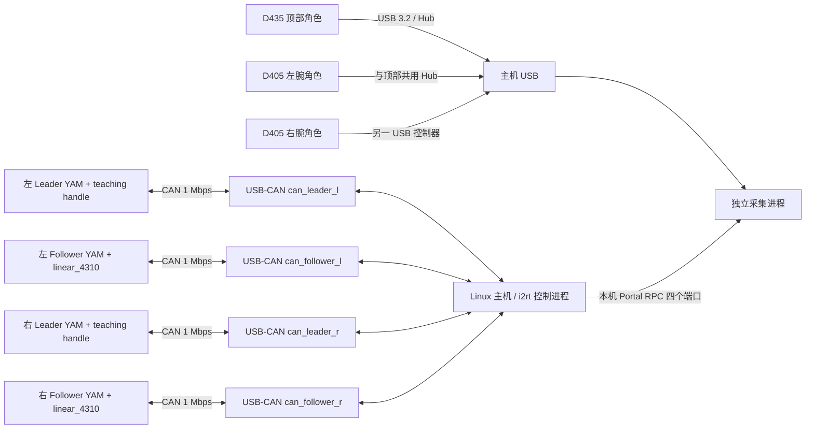
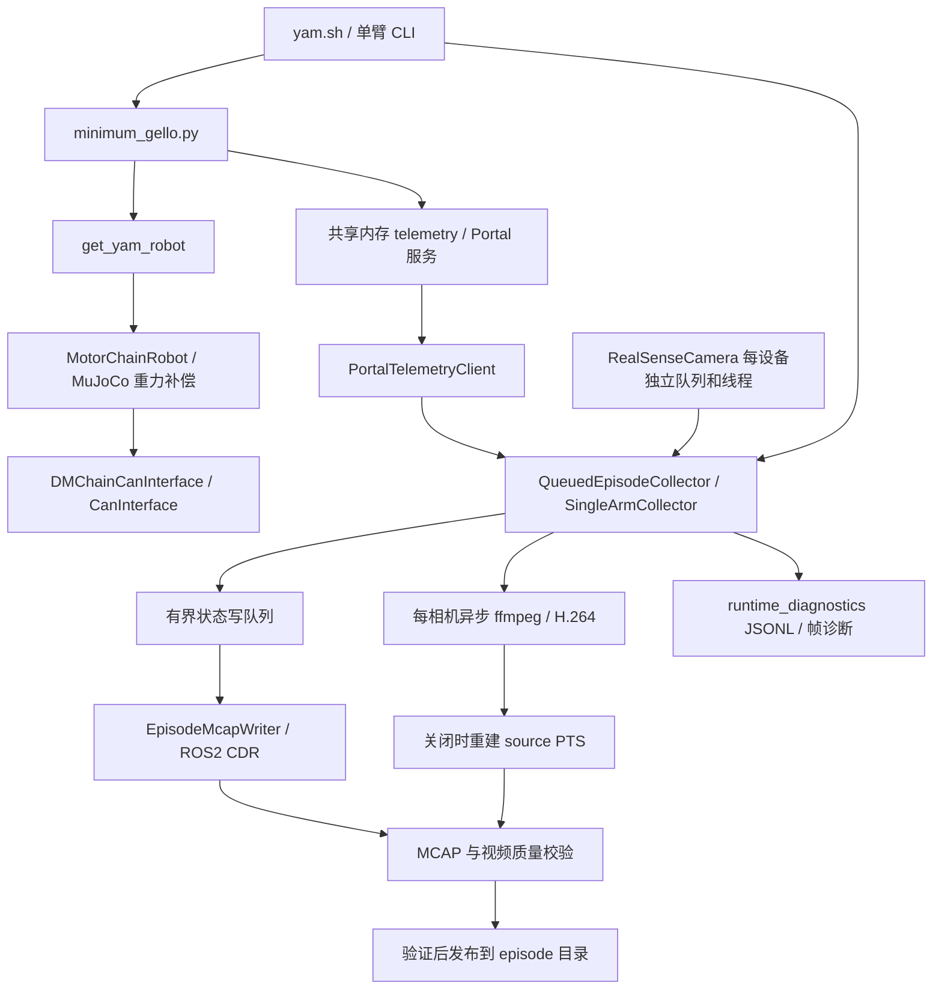

# YAM 数据采集系统架构与审计边界

审计日期：2026-11-15。本文以当前工作副本、真实 MCAP/MP4、部署报告和历史交接快照为证据。全文约定：**源码确认**表示可以沿调用链验证；**实测**表示本次读取了文件；**历史记录**表示来自既有日志、文档或参考对话；**工程推断**不代表原作者已经确认的设计动机。

## 系统与版本

| 路径/入口 | 实际用途 | 必须区分的行为 |
|---|---|---|
| `yam.sh capture` | 当前本机双臂采集 | `QueuedEpisodeCollector`、180 Hz、H.264-final、source 视频时间线 |
| `yam_single_arm.sh capture` | 后续增加的单侧主从采集 | `SingleArmCollector`，仅选中侧两路状态；腕部或腕部+顶部 |
| `yam-data-collect capture` | 基础 CLI | `EpisodeCollector`；不能与本机 shell 入口视为完全相同实现 |
| `config.example.yaml` 与早期 profile | 便携示例及历史实验 | 某些配置最终 HEVC，部分 D405 为 640×480；不是当前 host 参数 |
| `handoff/yam_single_arm_transfer_20261112/` | 11 月 12 日交接快照 | 起点默认、限速和启动异常处理与当前副本有差异 |
| 根目录 11 月 7 日压缩包 | 更早的部署来源 | 未发现 Git 对象；不作为当前参数权威来源 |

未在当前业务源代码中发现 ZED 图像采集实现。不能将 SDK 中其他机器人型号或早期示例拼进当前采集配置。

## 硬件连接

连接位置来自 `deploy/hardware_inventory.json` 和 `DEPLOYMENT_HOST.md`，不是本次重新枚举硬件。三路相机的物理安装朝向和外参未见完整测量记录。USB-CAN 可确认 `gs_usb`、VID/PID `1d50:606f`，具体商业型号待确认。公开交付不含真实设备序列号。

## 软件与调用关系

控制进程拥有 CAN；采集器通过只读遥测连接控制进程，不重复打开 CAN。可选的 `move`/`preposition` 是独立且显式确认的控制路径，不属于纯记录热路径。单臂配置复用双臂库，但验证器限制设备集合，不能用双臂验证命令替代。

## 进程、线程和资源

- `minimum_gello.py` 用 Portal 子进程分离硬件 worker 与 RPC/I/O，共享数组缓存位置、速度、力矩、时间和同步状态；命令采用 latest-wins。
- `MotorChainRobot` 有重力补偿更新线程，`DMChainCanInterface` 有独立 CAN 事务线程。二者通过命令/状态锁交换缓存。
- 采集器用线程池并行读取遥测，用状态采样线程按目标 180 Hz 工作；本机 queued 版本用容量 512 的状态写队列。
- 每相机有独立读取线程和容量 8 的 RealSense native queue；每视频写线程使用有界队列和独立 ffmpeg 进程。编码拥塞仍可经 CPU、磁盘和共享 MCAP 锁影响其他流，不能承诺完全无阻塞。
- 历史 host 将 CPU `0-11` 用于控制，`12-15` 用于采集，`16-19` 用于编码。它是本机配置，不是所有电脑的固定要求。

## 目录与证据索引

本公开包所选源码树见[release_project_tree.txt](audit/release_project_tree.txt)，逐文件大小/来源见[release_source_inventory.csv](audit/release_source_inventory.csv)。原工作区完整递归树、原始数据文件列表和内部路径仅在本地审计目录保留，不随公开包分发。源扫描未发现项目自有C/C++文件；Python/Shell为主要实现。

核心文件输入/输出和调用者见 [12_core_code_inventory.md](12_core_code_inventory.md)，更细的 AST 符号、参数、返回注解、import 与调用表达式见 `audit/release_symbols.json`。静态调用关系不能解析全部运行期 RPC、回调和继承分派，文中时序图补充了这些路径。

当前根目录 `.git` 是无对象的空目录，子项目及两个压缩包内也没有可用 Git 历史。本次未能完成 commit 级审计；已用交接快照比较和 SHA-256 建立可复核基线，见 [历史审计](audit/git_history.md)。
