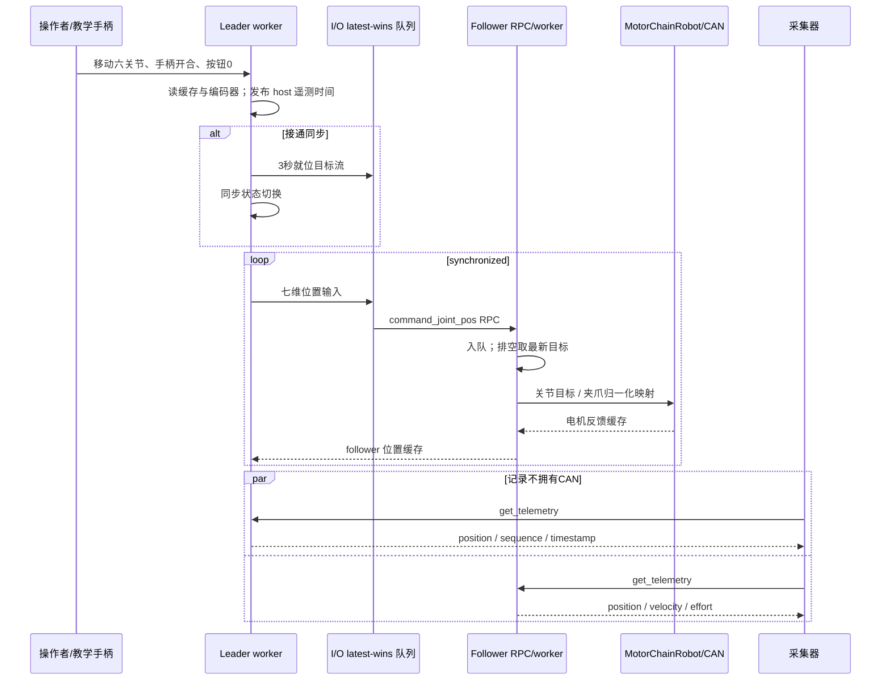

# YAM 硬件、Leader–Follower 与 CAN

## 可确认的硬件配置

| 项目 | 证据与结论 |
|---|---|
| 机械臂 | `yam.sh` → `minimum_gello.Args` 默认 `arm=yam, version=1`；对应 `yam_v1.yml` 和 `robot_models/arm/yam/v1/yam.xml`。实际铭牌/硬件修订未单独核验 |
| 完整布局 | 两个 Leader、两个 Follower；单臂入口只启用其中一对 |
| 臂关节 | 每条臂 6 个旋转关节，顺序 `joint1..joint6`；数据中再拼接 `gripper` |
| 电机 | 配置 ID `0x01..0x03: DM4340`；`0x04..0x06: DM4310`。这是配置证据，未拆机核对 |
| Follower 夹爪 | `linear_4310`，ID `0x07` DM4310；6.57 rad 电机行程、0.096 m 夹爪行程来自 stock limiter 配置，不等于本次测得精度 |
| Leader 手柄 | `yam_teaching_handle`，无夹爪驱动电机；同 CAN 上的被动编码器提供手柄开合与两个数字输入 |
| CAN | SocketCAN、1,000,000 bit/s、`restart-ms 0`、`txqueuelen 2000` |
| SDK | 本地修改版 `i2rt`，pyproject 版本 1.1.2；不是任意干净上游 1.1.2 的等价替代 |
| 环境 | 两套 Python 3.11.15；控制环境 numpy 2.2.6、python-can 4.5.0、MuJoCo 3.8.1、Portal 3.7.3（本次只读查询安装包版本） |
| 控制计算平台 | 历史host为Linux x86_64、逻辑CPU 0–19，内核6.8.0-138-generic；CPU商业型号、内存/GPU规格未在部署证据中完整确认，不能从CPU分区反推 |

## 角色映射

| 角色 | CAN 接口 | Portal 目标/遥测端口 | 夹爪 |
|---|---|---:|---|
| 左 Follower | `can_follower_l` | 1235 | linear_4310 |
| 左 Leader | `can_leader_l` | 控制目标 1235；遥测 1245 | teaching handle |
| 右 Follower | `can_follower_r` | 1234 | linear_4310 |
| 右 Leader | `can_leader_r` | 控制目标 1234；遥测 1244 | teaching handle |

这些地址为本机 loopback。左右各自一对一映射，数组按相同关节顺序传递，没有左右镜像变换；两侧独立控制进程，没有跨左右臂的控制屏障或硬件同步触发。一次 180 Hz 记录批次共用 `log_time` 不代表四条臂同时执行。

## Leader 到 Follower 的实际路径

`YAMLeaderRobot.get_info()` 从 `MotorChainRobot.get_observations()['joint_pos']` 读取六个关节缓存，再从 `get_same_bus_device_states()` 取得手柄编码器。手柄原始周期计数先按 4096 counts/rev 居中，转成弧度，限制到 ±0.7 rad 并归一化；Leader 最后一维为 `clip((1 - encoder.position - closed)/(open - closed),0,1)`。

右手柄启动器另带实测端点参数；公开代码包用占位符替换，目标机必须自行测量，不能照搬。Leader 末维是操作输入，既不是夹爪电机角度，也不是实际夹持力。

按钮 0 切换 `synchronized`。接通时执行约 3 秒、100 步的 follower 平滑就位，期间保持实时遥测更新；随后把 Leader 七维目标送入命令队列。Follower RPC 收到数组后入队，硬件 worker 每轮排空队列只取最新目标，再调用 `command_joint_pos`。SDK 将归一化夹爪目标映射回电机行程，应用限位、增益、重力补偿与夹爪力矩限制。

源码支持 bilateral feedback；本机 `yam.sh` 对 Leader 传入 `--bilateral-kp 0.0`，不能声称当前部署启用了非零双向力反馈。

## 频率与通信

`_WORKER_LOOP_PERIOD_S=0.002` 只是缓存读取 worker 的 sleep 上限，实际循环包含读取、锁与 RPC。`dm_driver.py` 的 `CONTROL_FREQ=250` 被用于带宽估算；当前 CAN 事务循环未按 `CONTROL_PERIOD` 实现严格 deadline，只在通信及编码器读取间 sleep。因此“250 Hz CAN”“500 Hz 控制”不能当成实测值。MCAP 只能测量约 180 Hz 写入及遥测导出时间，无法反推每个电机控制包的发送频率。

`CanInterface` 创建 `python-can` SocketCAN Bus，发送标准帧（非扩展 ID）。MIT 指令打包位置/速度/Kp/Kd/力矩；接收按 `ReceiveMode.p16`（motor id 左移4位）映射 ID，解包位置、速度、力矩、状态码与温度。手柄使用独立 passive encoder 协议。每电机事务等待约 10 ms，常规最多 5 次重试，若干电机/编码器路径设为 15 次；启动前 drain 清除旧帧。

CAN 后台线程有 `command_lock`、`state_lock` 和 `same_bus_device_lock`。当前链显式拒绝 buffered reader，直接事务式收发；不是多个线程任意竞争同一接收器。`enable_auto_recovery` 默认 false；可选清错重使能不能当成 USB 断连自动恢复。总线与驱动错误最终使控制链停止并由 worker 健康检查传播；设备重新接入仍需操作者维护。

## 使能、零点、限位与停止

工厂函数在构建真实链时会使能电机，线性夹爪配置 `needs_calibration: true` 可触发端点校准。SDK 可根据角度调整 ±2π wrap offsets；这不替代电机物理零位标定。零点维护脚本是显式操作，本次未执行。

限位来自 MJCF，工厂在两端各扩大 0.15 rad 后传入控制器；这是扩大容许范围，不应解读为缩小安全边界。预编程路径同样读取该限位。关节目标会 clip，启动超限检查可提示零位偏移。

`ClientRobot` 单次 RPC 等待约 0.25 s、失败重建客户端；Leader 连续 follower-RPC 故障约 1 s 后停止路径。`enter_gravity_comp_idle` 清除位置保持并保留重力补偿；它不同于电机断电或硬件急停，也不保证夹爪继续夹持。Ctrl+C 和异常清理只能尽力执行，进程强杀、掉电、硬件故障没有软件保证。

## 新增预编程就位版本

当前单臂 CLI 默认读取实时起点，`--from-recorded` 才检查文件起点。两条臂分别读取自己的起点，并行向同一个实测目标移动；目标为六个 rad 加一个归一化夹爪值。关节限速 **1 rad/s**，Follower 夹爪限速 **0.25/s**，发送计划频率 **25 Hz**，计划时长 **0.5–120 s**，到位/一致性容差 **0.12 rad / 0.12**。

Leader 手柄夹爪是被动机构，程序只能移动其六个臂关节；手柄需人工放到目标开合附近。`preposition_pair()` 检查同步未接通、按钮松开、接口版本、遥测新鲜度、目标及释放后的一致性。失败取消配对运动且不进入采集。该过程是并行软件启动，无硬件级同时起停保证，也没有碰撞规划。

证据：`yam_single_arm_collection/motion.py`、`cli.py`、`i2rt/examples/minimum_gello/minimum_gello.py`。11 月 12 日快照限速仍为 0.25 rad/s，不能混用旧说明。
