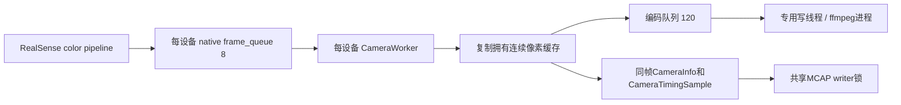

# RealSense 多路相机采集

## 当前 host 配置

| Camera Name | Model | 60 Hz 分辨率 | Configured FPS | 输入像素格式 | 安装角色 |
|---|---|---:|---:|---|---|
| cam_high | Intel RealSense D435 | 960×540 | 60 | yuyv | 顶部视角 |
| cam_left | Intel RealSense D405 | 848×480 | 60 | yuyv | 左腕视角 |
| cam_right | Intel RealSense D405 | 848×480 | 60 | yuyv | 右腕视角 |

30 Hz 模式三路均为1280×720、YUYV。D405 640×480 的 production/validation YAML 是独立历史候选，不是当前 host 模式。设备支持更多档位不等于已经通过完整采集验收；历史参考对话列出的90 FPS档位未构成正式系统验收。

以上型号、USB 3.2连接和固件来自 `deploy/hardware_inventory.json`：D435固件5.17.0.10，左D405为5.12.14.100，右D405为5.15.1.55。SDK使用 pyrealsense2 2.56.5.9235。本次未打开真实相机。序列号绑定采用 `enable_device(config.serial)`；USB `/dev/videoN` 可改变，不能代替稳定身份。公开配置仅含替换占位符。

## 图像数据

`RealSenseCamera.start()` 仅启用 `rs.stream.color`，没有 depth stream、深度对齐、点云或硬件帧同步配置。YUYV由SDK返回uint16二维或uint8二通道，`_copy_yuyv`规范为连续 `H×W×2 uint8`；字段名虽然叫 `image_bgr`，其真实字节布局由 `pixel_format=yuyv422` 表示。可选 `bgr8` 路径对应 `H×W×3 uint8 / bgr24`。

正式采集无裁剪、无resize、不做在线去畸变；ffmpeg将输入转为 `yuv420p` 并编码。桌面预览会进行显示所需颜色转换和刷新节流，它不改变录制分辨率。当前单臂预览只显示选中腕部，最大10 FPS；选择wrist-top仍记录顶部视频，但不显示顶部窗口。

## 初始化、缓存与并发

采集器按配置构建相机，初始化和首帧检查由 `collector.py::_start_cameras_with_retry` 与 `_read_camera_startup_frames` 管理，启动失败最多3次、间隔1秒；首帧读取并行等待。进入正式工作后每设备一个 `_CameraWorker`，独立调用read，不按“先读左再等右”的串行方式工作。

copy保障RealSense帧释放后图像仍有效；`owns_image=True`允许编码器接受该缓存，避免再复制整帧。队列有界：短调度停顿可被缓存，持续滞后不会无限消耗内存；队列满抛错并使episode无效。相机回调仍会访问MCAP锁/状态锁，因此只是降低串行阻塞，并非硬实时隔离。

## 时间戳与异常

支持时显式开启sensor `global_time_enabled`。设备毫秒时间转为纳秒，global time需与主机相差不超过1秒并严格递增。启动最多约0.25秒等待global time生效；若回退到host_receive，则本session固定使用该来源，不在录制中无声切换。global time丢失、倒退、缺失、异常偏移或无彩色帧均报错。相机读默认1秒超时；运行中断连使当前episode失败，没有热拔插后无缝续录保证。

`CameraFrame`保留capture、host receive、device timestamp、domain和frame number。`/diagnostics/frame_timing`在结束阶段写入图像无关数组。它能区分设备源帧号缺口与主机交付抖动；无法把所有缺口归因于USB、相机内部或应用层其中之一。

## 内参来源与迁移

本机左相机曾更换，当前host使用对应设备/模式的出厂内参，畸变模型是真实 `inverse_brown_conrady`。顶部和右腕沿用同设备、同模式的历史棋盘标定。不要将`inverse_brown_conrady`改名为`plumb_bob`以绕过下游限制。换设备/模式后需重新获得匹配内参；公开包中的数值仅作为历史配置参考。

实测帧率、全部视频分辨率/帧数和历史相机测试的差异见 [08](08_yam_data_audit.md) 与 [09](09_yam_debugging.md)。视频平均帧率字段含容器时间线效果，不能替代相机capture时间间隔和设备帧号统计。
