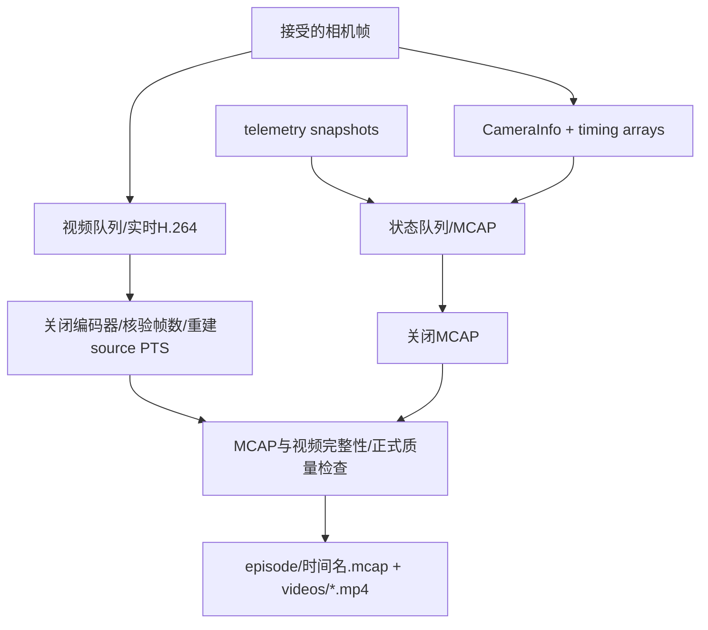

# MCAP、视频与发布契约

## MCAP 实现

`mcap_writer.py::EpisodeMcapWriter` 以 `xb` 独占创建文件，通过 `mcap_ros2.writer.Writer` 注册ROS2 msgdef Schema，CDR序列化消息。Schema为 `sensor_msgs/msg/JointState`、`sensor_msgs/msg/CameraInfo`、`std_msgs/msg/String`。Channel随首次写对应Topic建立；Schema编码为 `ros2msg`，消息编码为 `cdr`，无需启动ROS节点或ROS master。

writer内部锁串行化多个采集线程的写入，并维护独立的Topic sequence。`close()`具有幂等保护，`finish()`写结束结构和索引后关闭流。这个锁不等于每消息fsync；主机掉电可能破坏未落盘尾部，源码没有断电恢复事务保证。

## Topic、Schema 和字段

| Topic | Schema | 每条内容 | 记录时机 |
|---|---|---|---|
| `/task_info` | std_msgs/msg/String | JSON任务名/描述/ID；单臂附collection_layout，可附preprogrammed_preposition | writer初始化一次 |
| `/robot/arm_left_leader/joint_states` | JointState | Header、name[7]、position[7]、空velocity/effort | 目标180Hz |
| `/robot/arm_right_leader/joint_states` | JointState | 同上，右侧 | 同上 |
| `/robot/arm_left_follow/joint_states` | JointState | Header、name[7]、三个double数组各7 | 同上 |
| `/robot/arm_right_follow/joint_states` | JointState | 同上，右侧 | 同上 |
| `/robot/camera/cam_high/image_raw/compressed/camera_info` | CameraInfo | Header、height/width、distortion_model、d、k[9]、r[9]、p[12]、binning、roi | 每个接受图像帧一次 |
| `/robot/camera/cam_left/image_raw/compressed/camera_info` | CameraInfo | 同上，左腕 | 同上 |
| `/robot/camera/cam_right/image_raw/compressed/camera_info` | CameraInfo | 同上，右腕 | 同上 |
| `/diagnostics/frame_timing` | std_msgs/msg/String | version、role、capture/host/device时间数组、设备帧号数组、时间来源/domain计数 | 正常结束每路相机一批 |

双臂样本共9个Channel；单腕单臂样本5个Channel。Topic中的“compressed”不表示本文件保存了CompressedImage；真实MCAP中没有图像像素。消息数与真实Schema已由全量审计读取，见08及JSON报告。

## 三种 envelope/header 时间

| 消息 | MCAP log_time | MCAP publish_time | Header/JSON时间 |
|---|---|---|---|
| JointState | 采集器完成本批RPC后的host time | 遥测端导出snapshot的host time | Header同publish_time |
| CameraInfo | capture time | capture time | Header同capture time |
| frame_timing | 该相机最后一帧host receive | 最后一帧capture | JSON内含每帧capture/host/device |
| task_info | writer初始化host time | 同log_time | String无Header |

MCAP log_time不是通用“磁盘写入完成时间”。queued writer排队后仍保留先前采样时间，故`log-publish`不能测出写盘队列延迟。诊断批次写入发生在结尾，文件物理顺序也不要求跨Topic的log时间严格递增。单Topic逆序与全文件跨Topic回溯应分开统计。

## 当前视频路径

`AsyncFfmpegWriter`使用rawvideo stdin，输入YUYV422或BGR24，当前 `libx264 / CRF23 / ultrafast / 1 thread / avc1 / yuv420p / +faststart`。每相机一个ffmpeg进程，队列默认120帧；camera-test设置240。不是先把整个episode的原始图像攒入RAM再批量编码。

当前host最终codec同为H.264；验证后直接发布，不进行最终HEVC重编码。source时间线模式先实时编码，再由 `TimestampedVideoWriter.close()` 重设每包PTS/DTS；可安全处理的H.264包走remux，否则走验证后的decode/re-encode fallback。源码未显式设置GOP/keyint，不能宣称固定GOP值；它取决于编码器/所选preset的默认值。

历史HEVC配置则先生成轻量live视频，停止后串行转码到 `libx265 / hvc1`，核验解码帧数、分辨率和codec后发布。两条路径并存，当前H.264数据不应标记HEVC。



## MCAP与视频对应

同一路第i个CameraInfo对应同一路第i个接受的视频帧；先确认视频enqueue成功才写该帧的CameraInfo。时间来自同一个CameraFrame。source模式记录：

```text
PTS_us[i] = floor((capture_timestamp_ns[i] - origin_timestamp_ns) / 1000)
```

origin选首次有效机器人snapshot最早source时间，写入 `videos/source_timeline.json`。视频帧→相机capture时间→最近机器人Header时间构成对齐路径；源时间量化到微秒，不能宣称纳秒级视频精度。manifest仅保留各路首末时间和帧数，完整逐帧时间在MCAP CameraInfo/diagnostics中。

还需核对容器start offset；本次完整解码样本逐帧PTS差统计见08。固定FPS旧路径只有连续播放格点，不能不经核验直接套用上述source公式。

## 完整性与故障

使用 `.pending/<id>`、`videos_live/<id>.partial` 和 `.partial.mp4` 分阶段完成。视频退出码、短写、队列溢出、解码帧数不一致均阻止正常发布；进程内rename及rollback降低半成品风险，但MCAP和多个MP4的发布不是文件系统级多文件原子事务，也没有fsync级断电保证。

双臂CLI提供`publish-pending`/`transcode`等显式恢复入口，仅适用于可正常读取且视频齐全的pending资产；未关闭、缺失footer的MCAP不保证可修复。30Hz补帧工具只生成可追溯派生数据，不恢复真实丢失图像，单臂CLI未提供同等恢复工具。
