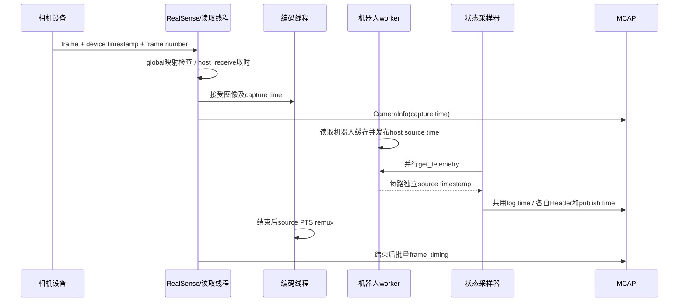

# 时间戳、同步与丢帧诊断

## 时间基准和可证明的边界

同主机机器人遥测使用`time.time_ns()` Unix时间，相机优先使用RealSense映射到系统时钟的global time。没有证据表明使用了外部触发、PTP、共享硬件采样时钟或ROS message_filters。`time.monotonic()`用于线程调度、超时和间隙检测，不被误当作Unix时间写入Header。

RealSense global time是SDK的时钟映射，不等于三台相机同时曝光。机器人时间标记的是发布缓存snapshot的主机时刻，不是总线每个关节的硬件采样时刻；六关节反馈本身按CAN事务依次到达，MCAP无法恢复每关节原始采样偏差。

## 三类对齐

1. 相机之间：异步采集，保存每路capture时间。基础质量检查用`_mutual_pair_offsets()`计算互为最近邻的配对误差，并报告orphans；它不是外触发同步。孤立未配对帧不能仅凭配对误差为小就忽略。
2. 图像与机器人：基础双臂`_check_joint_camera_sync()`合并四路Header后为每帧找最近状态。此检查可能由任意一条臂覆盖；单臂质量器分别检查所选Leader和Follower，要求两者都覆盖。审计另外逐路计算，不把基础“合并后通过”当作四路各自保证。
3. Leader与Follower：同批记录共用log time，source Header有差异，控制传递还有RPC、队列、CAN与机械响应延迟。最近邻时间差只反映记录时间接近度，不是物理跟随误差或运动响应时延。

## 当前门限与历史门限

| profile | 相机平均FPS | 最大间隔 | 相机间/关节图像同步 | 精确分辨率 |
|---|---|---:|---:|---|
| yam_60hz | 59.0–60.5 | 69 ms | 17 / 17 ms | 基础profile不强制；单臂额外强制 |
| yam_60hz_strict | 59.5–60.5 | 35 ms | 17 / 17 ms | 强制 |
| yam_30hz | 29.5–30.5 | 69 ms | 34 / 34 ms | 基础profile不强制；单臂额外强制 |

状态平均频率正式门限仍为>45 Hz，不是“恰好180Hz”。当前实现检查进程中的source间隙和采样间隙，但一个文件通过正式验证不代表没有source frame drop。现存README里的“±0.5Hz”检查名称与`yam_60hz`允许59.0Hz的实际下界不完全一致；以`validation_profiles.py`数值为准。11月7日历史报告采用当时59.5Hz边界，不能用现在的下界追认它当时已通过。

## Frame Timing Diagnostics 已确认存在

`EpisodeMcapWriter.write_camera_timing_diagnostics()`输入`CameraTimingSample`列表；每帧保存capture、host receive、device time、device frame number、domain/source。MCAP消息为String(JSON)，每相机通常一次，**不是60Hz诊断Topic**。

`quality.py::_camera_timing_diagnostics()`结合以下证据输出信息性检查：source vs host间隔、frame-number缺口、重复/倒退、交付延迟和时序来源。运行期`runtime_diagnostics.py`还将状态采样耗时、视频队列、ffmpeg pipe写耗时、accepted/submitted/dropped计数以及进程/系统负载记录到JSONL。

诊断Topic本身保存证据；帧率异常判定在采集器preflight、camera-test和quality检查中完成，不应把检测逻辑全归给String writer。若异常退出前尚未写结尾批次，CameraInfo可能存在而frame_timing缺失，这时不能证明设备连续性。

## 统计口径

本次脚本为 `scripts/audit_dataset.py`（从release根目录），全量按**文件顺序**读MCAP并检查CRC，避免默认时间排序掩盖倒退。

- 频率=`(N-1)/(last-first)`，不将各episode间的人工等待算入；汇总加权频率=总间隔数/总episode内时间跨度。
- 平均间隔、P95、最大间隔、标准差直接由相邻时间戳算出；正间隔中位数的倒数仅是另一种频率摘要，不替代平均频率。
- 重复总数=`N-unique(timestamp)`，另记相邻重复；逆序由相邻差<0识别。
- 相机设备丢帧计数为相邻device frame number正跳跃减1之和；它包括设备或传输链路未交付的帧，不能直接定位丢失层级。
- 逐Topic MCAP sequence缺口与设备帧号缺口分开统计。writer sequence是写入时生成，连续不证明硬件源没有丢样。
- 审计同步分布使用有方向最近邻，含边界帧；与正式互最近邻相机门限不是同一算法，不能直接替代原验证器。
- `log-publish`为导出到采样完成的可观测年龄；`host-capture`为相机映射/交付差。CAN内部缓存年龄、真正曝光差、写盘完成延迟无法从现有文件精确算出。

真实统计表、设备帧号缺失、重复、逆序和抽样PTS核验见[08](08_yam_data_audit.md)。异常根因的证据等级见[09](09_yam_debugging.md)。
