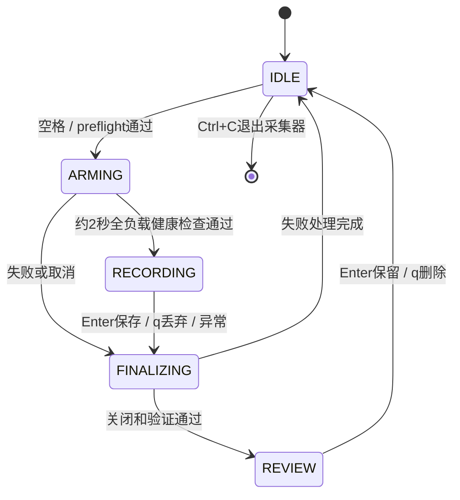

# Episode 生命周期与文件组织

## 生命周期



源码枚举以`CaptureState`为准；REVIEW是终端交互阶段，不一定是枚举值。无单条episode暂停/从中间续录功能；下一条episode是新文件。预编程就位在采集器启动前执行并检查，失败不进入采集。不得把退出采集器视为停止机械臂控制服务。

`_next_episode_id()`从数字目录、旧式MCAP命名、pending/live/partial目录中寻找最大ID加一，避免覆盖既有数据。同数据集有排他操作锁。缺号可以来自删除或历史整理，不表示能推算删除了多少真实记录。

## 真实文件布局

双臂真实样本位于`yam_data_collection/data/yam_host_20261107_h264_final/60hz_d435_960x540_d405_848x480_h264_final/0/`：

```text
dataset/
├── record_config.yaml
├── 0/
│   ├── 2026-11-07_20-43.mcap
│   └── videos/
│       ├── cam_high.mp4
│       ├── cam_left.mp4
│       ├── cam_right.mp4
│       └── source_timeline.json
└── runtime_diagnostics/           # 存在时为session级JSONL
```

真实单臂示例为`yam_single_arm_collection/data/left/wrist/样例/5/2026-11-10_23-54.mcap`，其`videos/`只有`cam_left.mp4`和`source_timeline.json`。同目录MCAP实际仅左主从两状态流、左CameraInfo、task_info和frame_timing。该例元数据还记录了`preprogrammed_preposition`。

单臂默认输出`data/<side>/<wrist|wrist-top>/<60hz|30hz>/`；现有数据被人工按session目录整理，目录名不是严格任务真值。多路视频只算同一条episode一次，不累计成三倍时长。

## 元数据

`record_config.yaml`保存解析后配置、选中mode、频率、角色、内参、任务信息等。它是dataset级快照，启动可重写；不是不可变逐episode配置溯源系统。`/task_info`是逐文件任务字符串，可包含单臂side、camera组合和就位证据，包括plan SHA-256、起点/终点、目标、时长和start_mode。

真实数据中仍存在`SINGLE_ARM_SMOKE_TEST`等占位任务ID。即使画面已用于实际任务，不能由文件夹名自动纠正其任务标签。公开包仅放脱敏模板，不放原MCAP、视频、任务全文或设备身份。

## 两种时长

终端“本条采集时长”从`recording_started_at_ns`到`recording_stopped_at_ns`，排除arming和保存时间。当前writer在ARMING阶段就记录状态与视频，正常成品未裁去这段，因此本次审计的**首末机器人log时间跨度包含arming数据**，通常比终端显示多约2秒。`task_info`初始化和结尾诊断消息又可能稍早/稍晚，MCAP全消息跨度也有区别。

08提供每条episode的机器人记录跨度，附完整CSV；不能与终端操作者动作时长或统计脚本旧口径直接混算。source timeline origin可能早于task_info初始化，因为它选择机器人source timestamp。

## 失败、中断与恢复

| 情况 | 当前实际行为/限制 |
|---|---|
| 显式q丢弃或正式质量失败 | 当前终端采集器可自动删除该条MCAP/视频；新版本追加`deleted_episode_durations.txt`时长账。此次审计未触发采集/删除 |
| 相机断连/状态变旧/队列满 | 当前episode无效，清理或保留可诊断pending由故障阶段决定；不自动重试机器人运动 |
| 编码或发布失败 | 尽量保留pending/live证据，避免标成完整成品；存在回滚逻辑 |
| 可读pending H.264 | 双臂`publish-pending`可显式复核后发布；不保证适用于单臂契约 |
| 未正常关闭MCAP | 无内置通用重建索引/修复footer保证；外部恢复需单独验证 |
| 磁盘满/写I/O失败 | 写入异常会向采集器传播，但没有预留空间与掉电持久化承诺；可能无法完整写诊断 |
| 强杀、掉电 | finally、rename和日志都可能来不及完成；不能无缝恢复原episode |

数据修复模块针对特定30Hz缺口复制上一图像并生成独立派生集及manifest；它不恢复真实丢失内容。本次只读审计没有调用任何修复、转码、元数据改写或删除入口。
