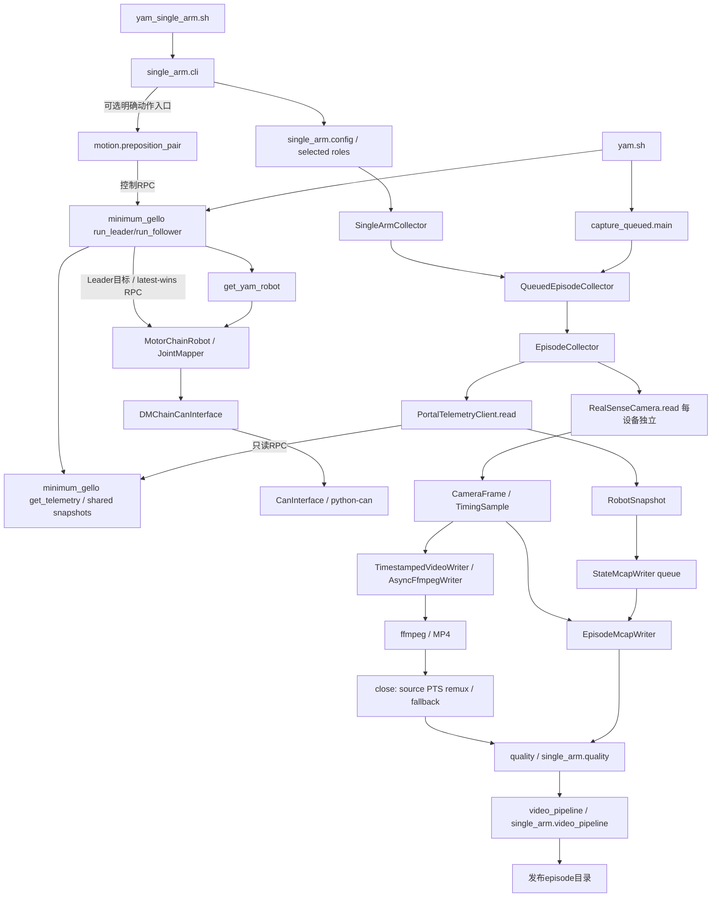

# 核心代码清单、接口与调用关系

下列路径相对原工作区根目录；独立交付包中的同一文件位于`src/<原路径>`。本次保留包边界、模型相对路径及继承关系，没有将控制栈拆成新的robot/camera子包。`SOURCE_MANIFEST.json`逐文件列出246个来源文件、原始/发布SHA-256、大小及脱敏标记；[release_source_inventory.csv](audit/release_source_inventory.csv)为可筛选清单。

本章给出核心路径的输入、输出、依赖、调用者和职责。[release_symbols.json](audit/release_symbols.json)进一步列出所选Python文件的类/函数、行号、签名、返回注解、import和静态调用表达式。AST不等于完整动态调用图；RPC、回调、线程入口和子类覆盖以下文及01/02/06的时序图为准。

## 1. 启动、配置与部署

| 文件 | 核心入口 | 输入 | 输出 | 依赖 | 调用者 / 系统职责 |
|---|---|---|---|---|---|
| `yam.sh` | shell子命令分派、CAN门禁 | role、capture/camera-test/check参数、环境mode | 控制进程或queued采集进程 | 两套venv、taskset、ip、ss、minimum_gello | 操作者；当前双臂部署主入口，H.264-final/source路径 |
| `yam_single_arm.sh` | 根目录包装器 | 单侧CLI参数 | 单臂CLI执行结果 | collector venv、`python -m yam_single_arm_collection` | 操作者；保持相对路径和环境一致，普通控制子命令由CLI转发yam.sh |
| `yam_single_arm_collection/leader_motion.sh` | 选中侧CAN/端口门禁、预编程Leader启动 | left/right、--confirm-motion | 启用预编程接口的Leader控制进程 | i2rt/collector venv、minimum_gello、CAN模板 | 单臂CLI的leader-motion分支；不承担普通采集/相机命令分派 |
| `yam_data_collection/scripts/capture_queued.py` | `main` | config、mode、preview | queued终端采集 | `QueuedEpisodeCollector`、preview | `yam.sh capture`；区别于基础CLI |
| `yam_data_collection/yam_data_collection/cli.py` | `main`、`_capture`、`_validate`、`_camera_test` | argparse参数与YAML | 各功能命令及JSON/终端报告 | collector、quality、pipeline、camera_test | `yam-data-collect` entry point；基础capture用EpisodeCollector |
| `yam_single_arm_collection/cli.py` | `main`、`_show_config`、`_qualify_cameras` | side、wrist/wrist-top、mode、plan | 单侧采集/校验/姿态/计划结果 | 单臂config、collector、motion、quality | 单臂shell；动作与只读预览分开 |
| `yam_data_collection/yam_data_collection/config.py` | `load_config`、`load_camera_test_config`；各配置dataclass | YAML、capture mode | DatasetConfig/CameraTestConfig | PyYAML、validation_profiles | CLI、collector、qualification、export；合并模式并规范化路径/参数 |
| `yam_single_arm_collection/config.py` | `load_config`、`robot_roles`、`camera_roles` | host YAML、side、camera setup | 仅选中角色的DatasetConfig | 基础config、dataclasses | 单臂CLI/quality；不创建另一侧零数据 |
| `yam_data_collection/config.host.yaml` | capture_modes、telemetry、cameras、task_info | host/设备映射 | 60Hz与30Hz运行配置 | 设备标定、角色约定 | 当前双臂启动器；发布版是脱敏模板 |
| `yam_single_arm_collection/config.host.yaml` | 单侧输出、默认模式、task_info | site配置 | 单臂配置覆盖 | 基础host YAML | 单臂loader；发布版替换任务及设备身份 |
| `deploy/90-yam-can.rules`、`deploy/yam-can@.service`、`deploy/install_can.sh` | udev身份规则、systemd实例、安装器 | 四角色USB身份模板 | 稳定CAN名称和1Mbps配置 | root维护权限、gs_usb、udev、systemd | 操作者手动维护；不属于采集热路径 |
| `single_arm_transfer/install_can_single.sh` | 单侧安装/preview | left/right、preview | 仅选中侧规则和服务安装计划 | 四角色部署模板 | 操作者；不为另一侧启服务 |
| `single_arm_transfer/configure_cpu.py` | `main` | 可用CPU/可选--apply | CPU分组预览或交付副本配置 | Python stdlib、transfer marker | 迁移安装；默认预览，不是性能验收 |

## 2. 机器人、Leader–Follower 与通信

| 文件 | 核心类/函数 | 输入 | 输出 | 依赖 | 调用者 / 系统职责 |
|---|---|---|---|---|---|
| `i2rt/examples/minimum_gello/minimum_gello.py` | `run_follower/run_leader`、`YAMLeaderRobot`、`ClientRobot`、`_run_leader_control_loop`、`_run_yam_polling_loop`、telemetry helpers | 角色、CAN channel、Portal端口、Leader关节/手柄、Follower反馈 | 目标命令、共享状态、Portal控制/遥测服务 | get_yam_robot、Portal、共享数组、latest-wins队列 | shell启动器；主从控制、进程健康及可选预编程服务的核心 |
| `i2rt/i2rt/robots/get_robot.py` | `get_yam_robot`、`get_encoder_chain`、`_load_joint_limits_from_xml` | arm/version、gripper、channel、sim、增益/端点覆盖 | MotorChainRobot或SimRobot | 配置、XML模型、DMChain、PassiveEncoderReader | minimum_gello及SDK脚本；硬件工厂，实机路径可使能/校准 |
| `i2rt/i2rt/robots/utils.py` | `ArmType/GripperType`、`JointMapper`、`GripperForceLimiter`、`detect_gripper_limits`、`combine_arm_and_gripper_xml` | YAML/XML、关节/夹爪目标、测量及力矩 | 组装模型、归一化映射、限力后的命令 | numpy、模型资源、枚举配置 | 工厂/控制器；末维单位和夹爪物理语义的关键证据 |
| `i2rt/i2rt/robots/config/yam_v1.yml` | arm硬件参数 | ID/电机类型、方向、增益、重力补偿 | 六关节配置 | ArmType loader | 当前默认YAM v1；其他型号配置是SDK兼容资源 |
| `i2rt/i2rt/robots/config/linear_4310.yml`、`yam_teaching_handle.yml` | follower gripper / leader handle配置 | 驱动类型、校准/行程、映射参数 | 夹爪硬件配置 | GripperType loader | 工厂；不能把被动手柄当作可驱动夹爪 |
| `i2rt/i2rt/robots/motor_chain_robot.py` | `MotorChainRobot`、`JointStates/JointCommands`、`update`、`command_joint_pos`、`get_observations`、`enter_gravity_comp_idle` | 关节目标、缓存反馈、模型和增益 | 受限电机命令、position/velocity/effort observations | MotorChain、JointMapper、MuJoCo、线程锁 | worker/SDK客户端；重力补偿、控制模式、缓存读取及健康传播 |
| `i2rt/i2rt/robots/robot.py` | `Robot`接口 | 状态读取/控制抽象 | 标准Robot方法约定 | numpy/typing | ClientRobot、MotorChainRobot、SimRobot；统一接口 |
| `i2rt/i2rt/motor_drivers/can_interface.py` | `CanInterface`、`_send_message_get_response`、`_receive_message`、`_drain_bus` | SocketCAN channel、标准CAN帧 | 回复帧或有界失败 | python-can、time | DM motor/encoder驱动；事务收发、重试、旧帧清理 |
| `i2rt/i2rt/motor_drivers/dm_driver.py` | `DMSingleMotorCanInterface`、`DMChainCanInterface`、`MotorCmd`、`PassiveEncoderReader/EncoderChain` | MIT命令、位置/速度/Kp/Kd/力矩、encoder请求 | 电机反馈、手柄状态、受锁缓存 | CanInterface、MotorType、EncoderConfig | get_robot/MotorChainRobot；一个CAN事务线程按链访问设备 |
| `i2rt/i2rt/motor_drivers/utils.py` | `MotorInfo`、`MotorConstants`、`MotorType`、`ReceiveMode`、float/int转换 | CAN协议位域、型号 | 带协议量程的物理数值与状态枚举 | dataclasses/enum | dm_driver；力矩单位、ID映射与量化范围证据 |
| `i2rt/i2rt/utils/encoder_manager.py` | `EncoderConfig`、`PassiveJointEncoder.validate_encoders`及维护CLI | 手柄channel、固件/报告模式要求 | encoder身份/配置验证 | python-can、Pydantic等SDK依赖 | PassiveEncoderReader初始化；维护CLI另有写配置能力，非只读审计入口 |
| `i2rt/i2rt/robots/kinematics.py`、`i2rt/i2rt/utils/mujoco_utils.py` | 运动学/MuJoCo辅助 | 组装模型、关节状态 | 模型计算与重力项辅助 | MuJoCo、模型XML/mesh | 机器人控制/仿真；不表示Episode记录了EE pose |
| `i2rt/i2rt/robot_models/` | YAM及gripper XML/mesh | 模型相对路径 | MuJoCo模型、关节限位和惯性 | SDK资源 | 工厂/控制器/仿真测试；76,242,844 bytes资源是代码包主要体积来源 |
| `i2rt/i2rt/robots/sim_robot.py` | `SimRobot` | 同类关节目标/模型 | 仿真状态 | MuJoCo、Robot接口 | get_yam_robot(sim=True)及离线SDK测试；不模拟真实USB/CAN时延 |
| `i2rt/i2rt/utils/recording.py` | SDK独立JointState/MCAP recorder | SDK observations/补偿量等 | SDK专用录制文件 | MCAP/线程资源 | MotorChainRobot可选start_recording；与正式Episode契约分开 |
| `yam_single_arm_collection/motion.py` | `load_motion_plan`、`move_follower`、`preposition_pair`、`read_pair_poses` | 实测七维目标、实时/文件起点、side、确认条件 | 只读计划/姿态或显式控制结果 | Portal、numpy、SDK工厂限位 | 单臂CLI；实时起点默认、1rad/s上限、25Hz计划、到位检查，不做碰撞规划 |

## 3. 采集、时间线、记录和质量检查

| 文件 | 核心类/函数 | 输入 | 输出 | 依赖 | 调用者 / 系统职责 |
|---|---|---|---|---|---|
| `yam_data_collection/yam_data_collection/models.py` | `RobotSnapshot`、`CameraFrame`、`CameraTimingSample` | 源位置/速度/力矩、图像及源/host/device时间 | 跨模块数据对象 | numpy、dataclasses | telemetry/cameras/collector/writer；明确时间与pixel_format的边界 |
| `yam_data_collection/yam_data_collection/telemetry.py` | `PortalTelemetryClient.read` | endpoint、超时 | RobotSnapshot或TelemetryError | Portal、models、锁 | collector状态线程池；读已有控制器，不重复开CAN；超时重建client |
| `yam_data_collection/yam_data_collection/cameras.py` | `RealSenseCamera.start/read/stop`、`discover_realsense`、`_copy_yuyv` | role、serial、profile、内参 | CameraFrame、设备列表或CameraError | 延迟加载pyrealsense2、numpy | collector/camera-test；单设备队列、global-time/host来源固定、只采color |
| `yam_data_collection/yam_data_collection/collector.py` | `EpisodeCollector`、`_Episode`、`_CameraWorker`、`_FrameTiming`、`CaptureState` | DatasetConfig、相机/telemetry工厂、终端按键 | MCAP、live视频、timing/生命周期/质量结果 | telemetry、cameras、writer、pipeline、quality | 基础CLI/queued子类；ARMING、采样调度、并发、异常和保存流程 |
| `yam_data_collection/yam_data_collection/queued_collector.py` | `QueuedEpisodeCollector`、`_StateMcapWriter`、`_StateWrite` | 各路snapshot及既定capture time | 有界队列写JointState | EpisodeCollector、queue、线程 | 本机capture入口/SingleArmCollector；512状态写队列解耦锁竞争 |
| `yam_single_arm_collection/collector.py` | `SingleArmCollector.save_episode`、`parse_preview_fps` | 选中两路状态及1/2相机 | 单臂文件和匹配质量报告 | QueuedEpisodeCollector、单臂quality/pipeline | 单臂CLI；避免四路契约误判 |
| `yam_data_collection/yam_data_collection/mcap_writer.py` | `EpisodeMcapWriter`、`camera_info_message`、`_stamp` | Snapshot、CameraFrame、task_info、TimingSample列表 | ROS2 CDR MCAP消息及Topic sequence | mcap_ros2 Writer、threading | collector/状态写线程；锁、schema注册、时间选择、正常finish |
| `yam_data_collection/yam_data_collection/video.py` | `AsyncFfmpegWriter`、`TimestampedVideoWriter`、probe/transcode函数 | 连续YUYV/BGR像素、源时间、编码配置 | MP4/临时MP4、视频元数据、PTS时间线 | ffmpeg/ffprobe、numpy；source模式PyAV16 | collector/camera-test/pipeline；有界编码队列、关闭核验、remux或fallback |
| `yam_data_collection/yam_data_collection/video_pipeline.py` | `publish_live_episode`、`publish_pending_episode`、`transcode_episode`、`_publish_verified_episode` | pending MCAP、live视频、config | 核验后Episode文件或保留的中间产物 | video、quality、路径/备份辅助 | collector/CLI；当前H.264直发和旧HEVC转码是不同分支 |
| `yam_single_arm_collection/video_pipeline.py` | `validate_live_episode`、`publish_live_episode` | 选中角色资产 | 单臂发布结果 | 基础pipeline、单臂quality | SingleArmCollector；补齐单臂契约 |
| `yam_data_collection/yam_data_collection/quality.py` | `inspect_mcap`、`validate_mcap`、`validate_video_assets`、`_camera_timing_diagnostics`、`_mutual_pair_offsets` | MCAP/视频、ValidationPolicy | 检查列表、TopicStats、时序诊断 | mcap_ros2 reader、numpy、video probes | collector/CLI/pipeline；正式质量判定，不恢复源丢失内容 |
| `yam_data_collection/yam_data_collection/validation_profiles.py` | `ValidationProfile`、`get_validation_profile` | yam_60hz / strict / 30hz | 明确FPS/gap/sync/分辨率门限 | dataclasses | config/quality；防止历史档位混用 |
| `yam_single_arm_collection/quality.py` | `validation_policy`、`validate_mcap`、`validate_video_assets` | 单侧数据、side、mode | 逐选中臂/相机检查 | 基础quality、selected config | 单臂collector/CLI；分别检查Leader、Follower的图像同步 |
| `yam_data_collection/yam_data_collection/camera_test.py` | `CameraQualification.run`、`_Timing` | CameraTestConfig、duration、video开关 | report.json、可选视频 | cameras、video、时序摘要 | camera-test CLI；不启动机器人控制 |
| `yam_data_collection/yam_data_collection/runtime_diagnostics.py` | `RuntimeDiagnosticsMonitor` | collector快照、进程/系统计数器 | session JSONL | /proc、/sys、线程 | capture路径；采样状态循环、pipe/queue/系统负载，不等同逐帧落盘追踪 |
| `yam_data_collection/yam_data_collection/dataset_lock.py` | `DatasetOperationLock` | dataset根、operation标签 | 排他操作锁或DatasetBusyError | fcntl/文件描述符 | capture/publish/transcode；避免并发覆盖 |
| `yam_data_collection/yam_data_collection/live_preview.py` | `LivePreview`、图像降采样/转换辅助 | 相机/关节最新值 | 桌面预览 | Tk、独立预览进程、队列 | capture --preview；节流显示，不降采录制数据 |
| `yam_single_arm_collection/live_preview.py` | `WristCameraPreview` | 所选腕部frame | 最高10Hz腕部预览 | 基础preview、Tk | 单臂capture；wrist-top不增加顶部窗口 |
| `yam_data_collection/yam_data_collection/web_console.py`、`web_runtime.py` | WebCaptureRuntime、WebCaptureController、ArmProcessSupervisor、HTTP handlers | 本地web动作、预览和服务配置 | 本地状态/预览及控制进程管理 | collector、preview、HTTP/子进程 | 可选web-console；不是本次现存单臂数据的已证实录制入口 |
| `yam_data_collection/yam_data_collection/offline_repair.py` | `build_repair_plan`、`repair_30hz_episode`、`rewrite_mcap_with_repairs` | 特定30Hz source资产 | 带manifest的独立派生集 | video复制帧、MCAP decoder/encoder | repair-30hz显式入口；合成帧不是缺失物理帧恢复 |
| `yam_data_collection/yam_data_collection/experiment.py` | `run_experiment`、拓扑/环境/试验摘要函数 | 实验plan、试验时长/CPU策略 | camera实验报告和对比 | collector/camera topology、系统命令 | 显式experiment CLI；会访问硬件，本次未运行 |

## 4. 数据导出、元数据工具、离线审计与测试

| 文件/集合 | 核心入口 | 输入 | 输出 | 依赖 | 调用者 / 系统职责 |
|---|---|---|---|---|---|
| `yam_data_collection/scripts/convert_episode_to_lerobot_v21.py` | argparse主入口、时间重采样/特征转换辅助 | 双臂四状态、三视频、source时间线 | LeRobot v2.1目录/Parquet/视频 | numpy、PyAV及脚本声明的导出依赖 | 操作者离线显式导出；action=右Leader+左Leader，14维float32，不支持单臂 |
| `yam_data_collection/scripts/check_joint_camera_sync.py` | 离线同步检查CLI | MCAP/时间戳 | 同步检查摘要 | mcap_ros2、numpy | 人工排查；需与正式quality算法区分 |
| `yam_data_collection/scripts/summarize_dataset_duration.py`、`summarize_dataset_duration.sh` | 递归时长入口 | 文件/数据目录 | 每Episode一次的时长统计 | MCAP reader、collector环境 | 操作者；不把多相机视频时长相加 |
| `yam_data_collection/scripts/mcap_task_info.py`、`show_mcap_task_info.py`、`update_mcap_task_info.py` | 任务信息读取/显式更新 | MCAP和任务字段 | 任务摘要或改写文件 | MCAP/CDR工具 | 人工维护；update有写数据能力，本次禁止运行 |
| `yam_data_collection/scripts/calibrate_realsense_intrinsics.py` | 标定CLI | 真实相机、棋盘参数 | 新标定文件 | pyrealsense2/OpenCV等 | 现场维护；本次没有重新标定 |
| `yam_data_collection/scripts/validate_lerobot_dream.py` | 可选Dream验证 | 已导出数据 | 外部SDK校验结果 | 单独安装的Dream SDK | 可选集成；未随包vendor，未在本次运行 |
| `yam_data_collection/tests/`、`yam_single_arm_collection/tests/`、`single_arm_transfer/tests/` | pytest（包含在原模块边界） | 合成MCAP/像素、mock RPC、临时目录 | 461项本次通过 | pytest、FFmpeg/PyAV、Portal本地端口 | `release/scripts/test_offline.sh`前半；不打开真实设备 |
| `i2rt/i2rt/robots/tests/`中8个选中测试文件 | health/lag/telemetry/preprogrammed/motor/encoder回归 | 假Robot/CAN/Portal对象 | 43项本次通过 | SDK环境、pytest | 同一测试脚本第二组；不连接硬件 |
| `i2rt/i2rt/robots/tests/test_robot_variants.py`、`test_assembly.py` | 各arm/gripper资源装配和仿真 | XML/mesh、sim=True | 183项本次通过 | MuJoCo、numpy、pytest | 测试脚本第三组；其余SDK测试保留但不计入687项通过声明 |
| 新增`release/scripts/audit_dataset.py`、`audit_extra_videos.py` | 只读数据审计CLI | 现存文件、独立输出目录 | CSV/JSON统计 | MCAP、numpy、PyAV | 本次统计；无机器人导入/启动 |
| 新增`docs/audit/tools/audit_workspace.py`、`audit_runtime_logs.py` | 原始证据扫描 | 当前文件、JSONL/账本 | 文件树、AST、本地日志统计 | Python stdlib | 审计流程；本地结果可能含内部路径，不直接随公开包分发 |

导出工具的可选依赖不由最小`requirements.txt`完整覆盖；按导出脚本`--help`和导入错误准备单独环境。硬件模块虽可import，构建实机Robot或start相机会连接设备；离线可导入不等于可无硬件完整采集。

## 5. 主路径调用图

## 6. 数据对象契约与依赖边界

| 边界 | 输入 → 输出 | 关键约束 |
|---|---|---|
| CAN→SDK | 反馈位域 → MotorInfo/缓存 | 方向/offset/量程处理；不是直接raw encoder |
| SDK→telemetry | observations/Leader输入 → 共享快照 | host导出时间；Leader末维是映射输入 |
| RPC→采集器 | get_telemetry payload → RobotSnapshot | 超时、新鲜度/sequence检查；不拥有CAN |
| 相机→采集器 | SDK frame → CameraFrame | uint8 YUYV422/BGR24、明确所有权、capture/host/device时间 |
| 采集器→MCAP | 状态/CameraInfo/任务/diagnostics → CDR消息 | 状态log和source时间分离；CameraInfo无像素 |
| 采集器→视频 | accepted frames → 有界队列/MP4 | enqueue接受后才写对应CameraInfo；关闭时验证 |
| source时间→PTS | 纳秒capture-origin → 微秒PTS | 量化及容器固定offset需显式处理 |
| 文件→Action | 双臂Leader[7]右+左 → float32[14] | 最近邻重采样；不是已保存的执行命令 |

版本、第三方许可、未包含的原始数据/固件/flowbase/凭据及配置模板限制见`THIRD_PARTY_NOTICES.md`、`SOURCE_MANIFEST.json`和[工程审计](00_engineering_audit_report.md)。
